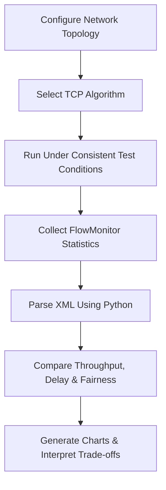

# TCP Congestion Control Performance Analysis
### NS-3.41 | Network Simulation | Performance Engineering

A research-oriented project examining TCP NewReno, Vegas, Cubic, and BBR through throughput, latency, and bandwidth-sharing fairness.

> Repository scope: Technical overview and evaluation design. Simulation files, datasets, and measured results are not included.

## Problem Statement

TCP congestion control determines how a sender adjusts its transmission rate as network conditions change.

This project examines a practical question:

**How do different TCP algorithms balance data delivery speed, packet delay, and fair access to shared bandwidth?**

## Evaluation Workflow



## Technical Approach

| Component | Responsibility |
|---|---|
| NS-3.41 | Network topology and TCP simulation |
| FlowMonitor | Per-flow measurement collection |
| Python / Pandas | Data extraction and analysis |
| Matplotlib | Performance visualization |

The comparison covers NewReno, Vegas, Cubic, and BBR. Each experiment should preserve the same topology, link settings, traffic duration, and measurement window while changing the algorithm under evaluation.

## Measurement Logic

```python
def throughput_mbps(received_bytes, duration_s):
    """Received data rate over a defined measurement window."""
    if duration_s <= 0:
        raise ValueError("Duration must be positive.")
    return received_bytes * 8 / duration_s / 1_000_000

def mean_delay_s(total_delay_s, received_packets):
    """Average delivery delay for successfully received packets."""
    return (
        total_delay_s / received_packets
        if received_packets > 0 else None
    )

def fairness_index(flow_rates):
    """Jain's fairness index for competing flows."""
    rates = list(flow_rates)
    if not rates or any(rate < 0 for rate in rates):
        raise ValueError("Provide non-negative flow rates.")
    denominator = len(rates) * sum(rate ** 2 for rate in rates)
    return sum(rates) ** 2 / denominator if denominator else None
```

This is an illustrative calculation layer, not a complete simulation.
Fairness must be calculated across flows competing within the same test scenario.

## Results & Discussion

The evaluation is organized around three questions:

- Throughput: Which algorithm delivers more data during the measurement window?
- Delay: What latency accompanies that throughput?
- Fairness: How evenly do competing flows share available bandwidth?

No numerical outcomes are published in this repository. Therefore, no algorithm ranking or performance improvement is claimed.

## Conclusion

The project defines an end-to-end approach to TCP performance evaluation: configure controlled experiments, collect per-flow statistics, calculate consistent metrics, and interpret the resulting trade-offs.

The engineering emphasis is on transparent methodology and evidence-backed comparisons. Determining the best-performing algorithm requires measured results from a documented test configuration.

## Project Period
December 2025 – January 2026
